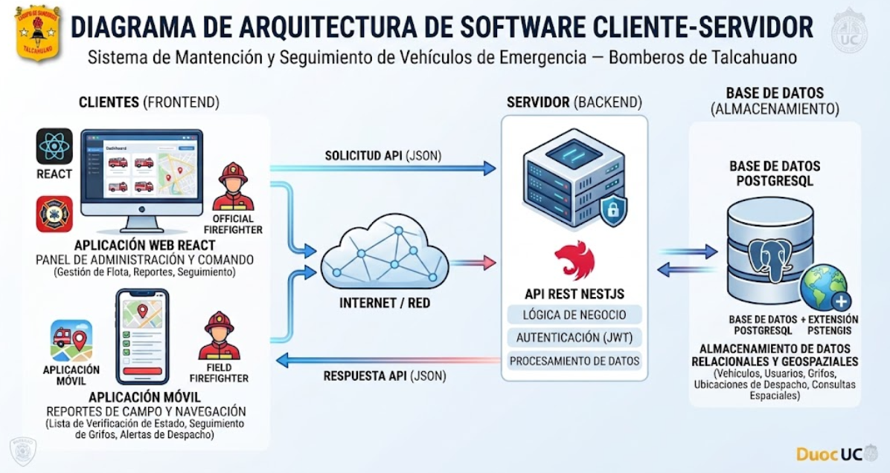

# SIGEV — Sistema de Control y Seguimiento de Mantención de Vehículos de Emergencia

**Compañía de Bomberos de Talcahuano** · Proyecto Capstone — Escuela de Informática y Telecomunicaciones, Duoc UC (Sede Plaza Vespucio).


-3ECF8E?logo=supabase&logoColor=white)


## 📋 Descripción

SIGEV es una aplicación web y móvil que centraliza la información operativa de la Compañía de Bomberos de Talcahuano:

- **Vehículos:** ficha técnica, kilometraje, estado operativo diario e historial de estados.
- **Mantenciones:** preventivas y correctivas, con trabajos realizados, artículos de inventario usados y costos.
- **Inventario:** artículos, categorías y movimientos de stock (las salidas se generan automáticamente al registrar una mantención).
- **Grifos:** catálogo georreferenciado, estado y revisiones históricas.
- **Despachos de emergencia:** creación, asignación de vehículos y personal, seguimiento en mapa y cierre, con notificaciones en tiempo real.
- **Estadísticas y dashboard** para la toma de decisiones.

El objetivo es reducir el tiempo de búsqueda de información antes de despachar unidades y apoyar las decisiones operativas.

Desarrollado con metodología ágil **Scrum**, en 4 sprints: Sprint 0 (configuración base) · Sprint 1 (carga de estados) · Sprint 2 (búsqueda de grifos y emergencias) · Sprint 3 (georreferenciación).

## 🏗️ Arquitectura



- **Clientes:** aplicación web (React, panel de administración y comando) y aplicación móvil (React Native / Expo, uso en terreno).
- **Servidor:** una sola API REST en NestJS con autenticación JWT que sirve a web y móvil, más un gateway **Socket.IO** para notificaciones en tiempo real.
- **Base de datos:** PostgreSQL + PostGIS **alojada en Supabase** (columnas geoespaciales en grifos, compañías y destino de despachos).
- **Despliegue:** el backend corre en **Render** (`https://api-backend-bomberos.onrender.com`) y se conecta a Supabase. **No se usa Docker.**

```
Web (React) ─┐                                   ┌─ Supabase
             ├─ HTTPS / WebSocket ─► Render ─────┤  PostgreSQL + PostGIS
Móvil (Expo)─┘                      (NestJS API)  └─
```

## 🧰 Stack tecnológico

| Parte | Tecnología |
| --- | --- |
| Web | React 18 + TypeScript + Vite · React Router · Axios · Leaflet (mapas) · Chart.js · socket.io-client |
| App móvil | React Native + Expo + TypeScript · React Navigation · react-native-maps · expo-location · expo-secure-store |
| Backend | NestJS + TypeScript · REST · Socket.IO |
| ORM | TypeORM (`synchronize: false`; el esquema se gestiona con script SQL en Supabase) |
| Base de datos | PostgreSQL + PostGIS en Supabase |
| Autenticación | JWT (vigencia configurable, 8 h por defecto, sin refresh tokens) · guards de roles |
| Validación | `class-validator` / `class-transformer` (ValidationPipe con whitelist) |
| Pruebas de API | Colección Postman en [`docs/postman`](./docs/postman) |
| Calidad / CI | oxlint (backend), ESLint (web), GitHub Actions |
| Despliegue | Render (backend) + Supabase (BD) |
| Control de versiones | Git + GitHub (monorepo con npm workspaces) |

## 📁 Estructura del repositorio

```
.
├── apps/
│   ├── backend/     # API NestJS + TypeORM (módulos por entidad, auth, notificaciones, estadísticas)
│   ├── web/         # Aplicación web (React + Vite + TS)
│   └── mobile/      # Aplicación móvil (React Native / Expo + TS)
├── docs/            # Arquitectura y colección Postman
├── Fase 1 / 2 / 3   # Evidencias académicas de cada fase
├── .github/         # Workflow de CI, plantillas de PR e Issues
├── CONTRIBUTING.md  # Flujo de trabajo con Git y convenciones
└── README.md
```

## 👤 Roles del sistema

| Rol | Alcance |
| --- | --- |
| `administrador` | Administración completa del sistema y matriz de permisos |
| `central` | Gestión institucional de emergencias y despachos |
| `comandante` | Supervisión operativa de todas las compañías |
| `director` | Responsable administrativo de su compañía con acceso completo a su información |
| `capitan` | Gestión del personal, mantenciones y operatividad de su compañía |
| `bombero` | Personal operativo de su compañía |
| `mecanico` | Gestión de mantenciones e inventario de su compañía |

La navegación y los permisos por rol se centralizan en `apps/web/src/config/navigation.ts` (web) y en los guards `JwtAuthGuard` + `RolesGuard` (backend).

## 🚀 Cómo levantar el entorno de desarrollo

### Prerrequisitos

- Node.js 20.x (ver `.nvmrc`) y npm
- Acceso a la base de datos de Supabase (cadena de conexión) — pídela al equipo
- Para la app móvil: la app **Expo Go** en el celular, o un emulador

### 1. Clonar e instalar dependencias

El repo usa **npm workspaces**: se instala una sola vez desde la raíz.

```bash
git clone https://github.com/ant000o/vehiculos-emergencia-talcahuano.git
cd vehiculos-emergencia-talcahuano
npm install
```

### 2. Variables de entorno

Los archivos `.env` **no se suben al repo**. Crea cada uno a mano:

**`apps/backend/.env`**

```env
DATABASE_URL=postgresql://<usuario>:<clave>@<host-supabase>:5432/postgres
JWT_SECRET=<secreto-largo-y-aleatorio>
JWT_EXPIRES_IN=8h
CORS_ORIGIN=http://localhost:5173   # opcional; separado por comas. Sin definir = cualquier origen
PORT=3000                           # opcional
```

**`apps/web/.env`**

```env
VITE_API_URL=http://localhost:3000
```

**`apps/mobile/.env`**

```env
EXPO_PUBLIC_API_URL=http://<IP-local-del-PC>:3000
```

> En un celular físico `localhost` no apunta al computador: usa la IP local de tu red, o apunta directo al backend en Render (`https://api-backend-bomberos.onrender.com`).

### 3. Backend (NestJS)

```bash
npm run dev:backend
```

API en `http://localhost:3000`. La base de datos es la de Supabase, no hay nada local que levantar.

Datos de prueba (⚠️ **trunca y recrea todas las tablas**, usar solo en entornos de prueba):

```bash
cd apps/backend
npx ts-node -r tsconfig-paths/register src/seed.ts
```

### 4. Web (React)

```bash
npm run dev:web
```

Disponible en `http://localhost:5173`.

### 5. App móvil (Expo)

```bash
cd apps/mobile
npx expo start
```

Escanea el QR con Expo Go.

## ☁️ Despliegue

- **Base de datos:** proyecto en Supabase con PostGIS habilitado. El esquema (tablas, enums, triggers) se creó con script SQL; por eso TypeORM corre con `synchronize: false`.
- **Backend:** servicio web en Render conectado a este repositorio. Variables de entorno configuradas en el panel de Render (`DATABASE_URL`, `JWT_SECRET`, `JWT_EXPIRES_IN`, `CORS_ORIGIN`). Arranque en producción: `npm run start:prod --workspace=apps/backend`.
- **Nota:** en el plan gratuito de Render el servicio se duerme tras un período de inactividad; la primera petición puede tardar unos segundos en responder.

## 🧪 Pruebas de la API

La carpeta [`docs/postman`](./docs/postman) incluye la colección con pruebas CRUD de las 13 tablas y los entornos *Local* y *Render Producción*. Ver [`README_POSTMAN.md`](./docs/postman/README_POSTMAN.md).

## 🌿 Flujo de trabajo con Git

Ver [CONTRIBUTING.md](./CONTRIBUTING.md): ramas, convención de commits y proceso de Pull Request. El CI (GitHub Actions) ejecuta lint y build de backend y web en cada PR a `main`.

## 👥 Equipo

| Integrante | Rol en el equipo | Frente de trabajo |
| --- | --- | --- |
| Antonio Campos Álvarez | Líder TI / Arquitecto de Software | Frontend web |
| Ignacia Reyes Espinoza | Product Owner | Aplicación móvil |
| Carlo Reyes Espinoza | Scrum Master | Backend y base de datos |

Docente guía: Diego Garcés Miranda. Working agreements del equipo en el documento **01 Squad y Responsabilidades**.

## 📚 Documentación del proyecto

La documentación de la Fase 1 (mapas, visión, épicas, historias de usuario, backlog) está en la carpeta [`Fase 1/Evidencias Grupales`](<./Fase 1/Evidencias Grupales>). Diagramas en [`docs/architecture`](./docs/architecture).

## 📌 Estado actual

El proyecto está en su recta final. Ajustes en curso:

- **Web:** el bombero no registra el nuevo estado del vehículo · el mecánico no ve grifos · registrar qué usuario creó cada ficha, estado o registro.
- **Móvil:** abrir el despacho desde la tarjeta · mantener la sesión abierta.
- **Web y móvil:** notificar la finalización de un despacho.
- **Base de datos:** agregar el tipo/nomenclatura del vehículo.
- **Roles:** Capitán (solo su compañía), Director (más información de su compañía) y Comandante (acceso total).

Ya resuelto: guardado automático de la dirección al pinchar el mapa, emoji en el mapa de despacho y botón de actualizar.

## Licencia

Proyecto desarrollado con fines académicos para la asignatura Capstone, Duoc UC. Uso y distribución sujetos a las políticas institucionales correspondientes.
