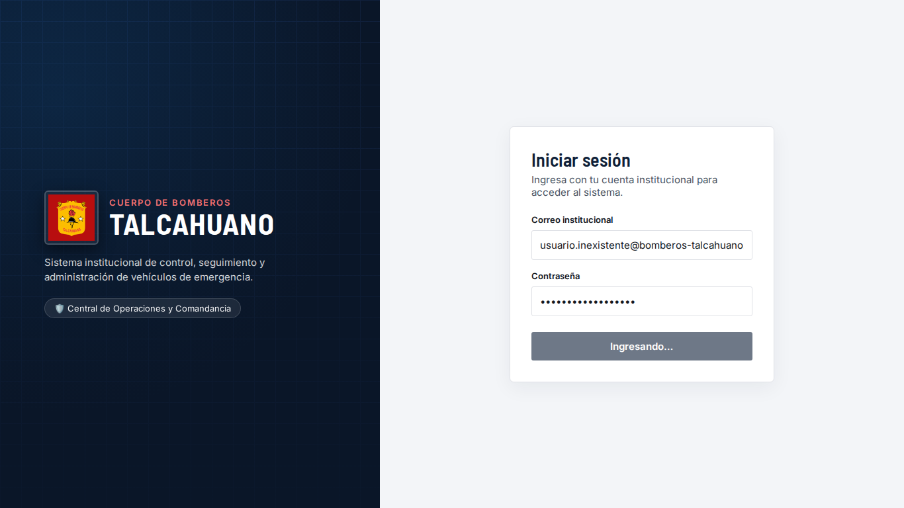
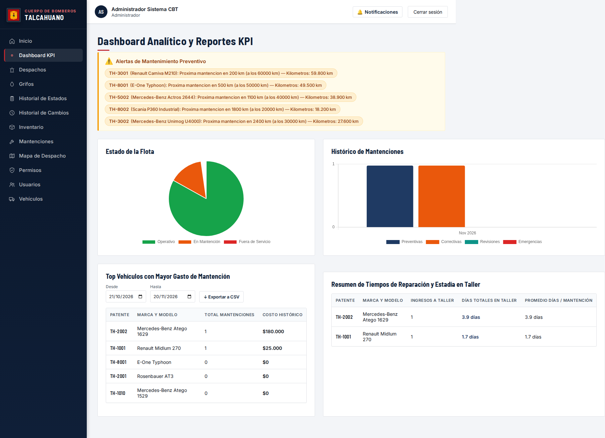
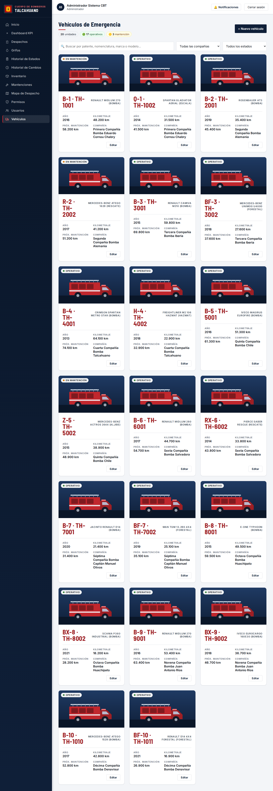
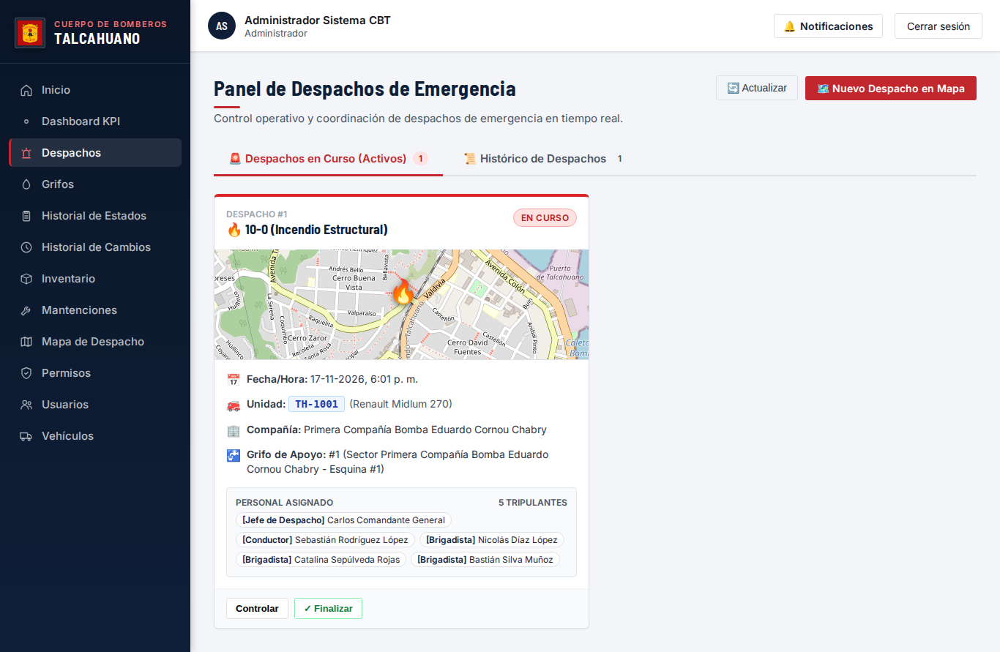
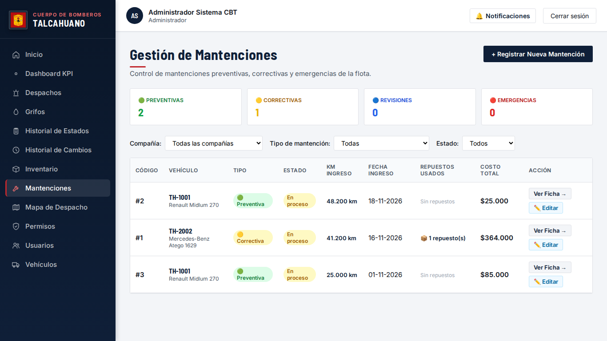
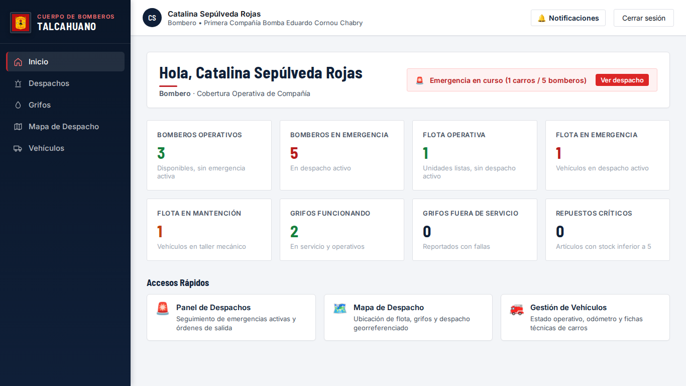
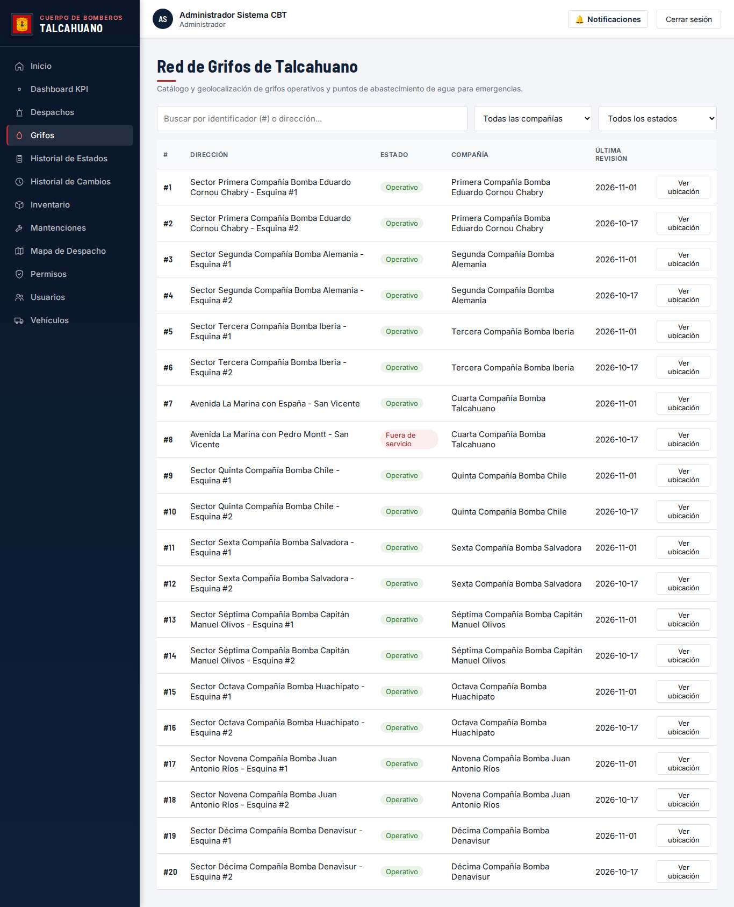
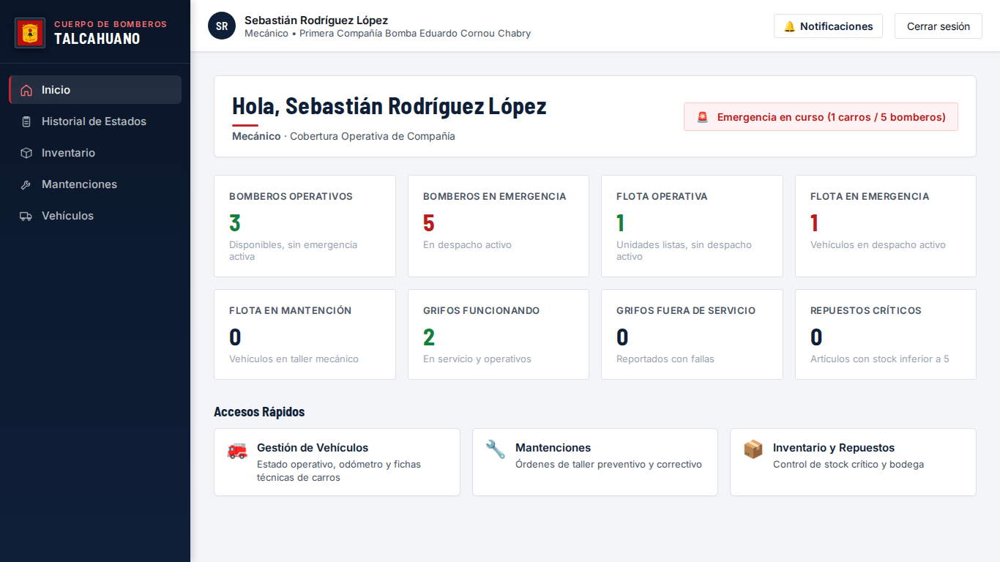
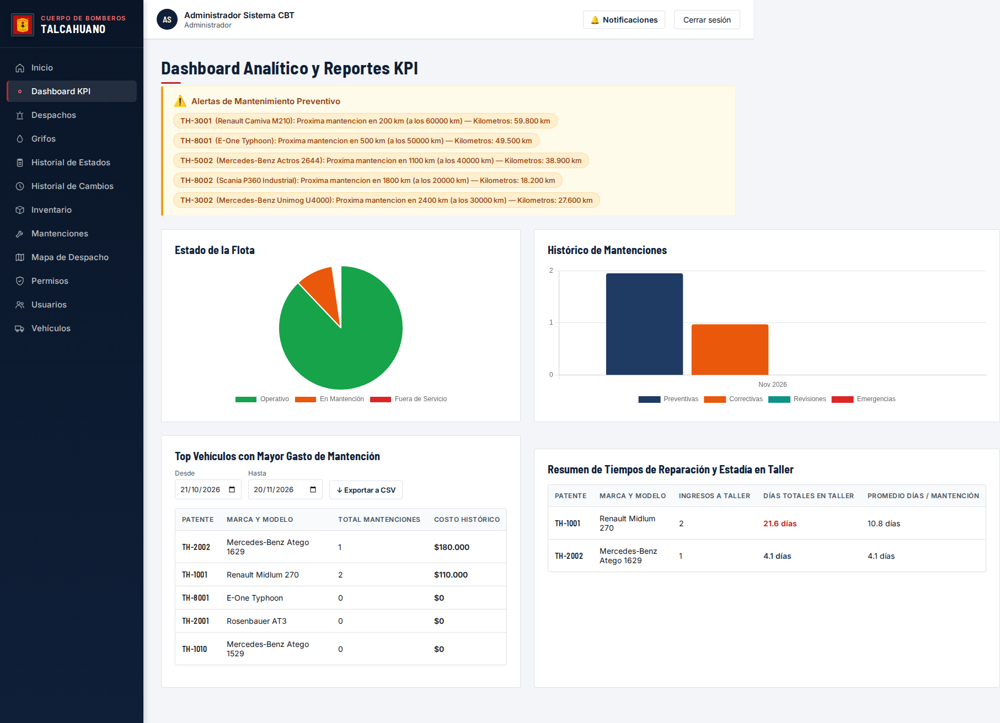
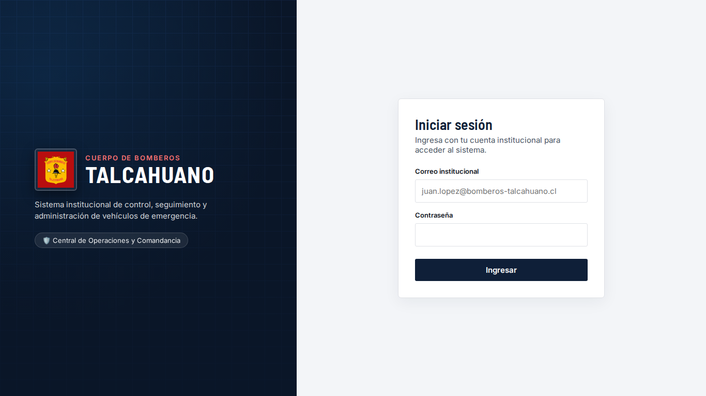

# Informe Técnico Detallado de Aseguramiento de Calidad (QA) — SIGEV Talcahuano

**Proyecto Capstone:** Sistema Integral de Gestión de Emergencias y Vehículos (`vehiculos-emergencia-talcahuano`)
**Organización destinataria:** Cuerpo de Bomberos de Talcahuano
**Institución:** Duoc UC — Ingeniería en Informática
**Autor:** Antonio Campos, Ignacia Reyes, Carlo Reyes.
**Fecha de informe:** 20 de noviembre de 2026

---

## 1. Introducción
Este informe presenta la trazabilidad técnica completa del proceso de auditoría, ampliación de pruebas automatizadas (integración/E2E y unitarias aisladas con mocks), medición real de cobertura con `@vitest/coverage-v8@2.1.9`, análisis estático, pruebas de estrés (sin token y autenticado contra base de datos) y SQLi/fuzzing sobre entorno local, corrección de defectos y validación de regresión aplicado sobre **SIGEV Talcahuano**.

## 2. Objetivo General y Objetivos Específicos
- **Objetivo general:** Verificar la funcionalidad operativa, el control de acceso por roles y alcances (RBAC/Scope), la resiliencia ante cargas o entradas inválidas y la estabilidad del monorepo SIGEV Talcahuano.
- **Objetivos específicos:**
  1. Auditar la arquitectura y el código fuente real de `apps/backend`, `apps/web` y `apps/mobile`.
  2. Ejecutar y ampliar la batería automatizada hasta **57 pruebas aprobadas** en `npm run qa:all` (incluyendo ciclo CRUD completo con limpieza en `QA-BE-CRUD-03`) más **20 pruebas unitarias con mocks** en `apps/backend/src`.
  3. Medir la cobertura real de código en Web y Móvil mediante `@vitest/coverage-v8@2.1.9` y ejecutar pruebas externas de estrés (autenticado y no autenticado) y SQLi/fuzzing.
  4. Corregir defectos identificados (`DEF-01`..`DEF-05` y controles de alcance/guards) y documentar con transparencia lo cubierto y lo pendiente.

## 3. Alcance de las Pruebas y Estado Real del Sistema
- **Alcance evaluado:** API NestJS + TypeORM + PostgreSQL/PostGIS (`apps/backend`), aplicación web React + Vite + Leaflet (`apps/web`) y lógica/servicios/reglas de la aplicación móvil Expo/React Native (`apps/mobile`).
- **Estado consolidado (`npm run qa:all`):** **57/57 pruebas automatizadas aprobadas** en 11 archivos de prueba, complementadas con **20 pruebas unitarias con mocks** en `apps/backend/src` (`src/qa-servicios-guard.spec.ts` y `src/qa-rbac-vehiculo.spec.ts`).
- **Ciclo CRUD completo con limpieza (`QA-BE-CRUD-03`):** Verificado creación (`POST /mantenciones` -> HTTP `201`), lectura (`GET /mantenciones/:id` -> HTTP `200`), actualización (`PATCH /mantenciones/:id` -> HTTP `200`, estado `'finalizada'`) y eliminación garantizada en bloque `finally` (`DELETE /mantenciones/:id` -> HTTP `200`), confirmando persistencia real sin dejar registros residuales en PostgreSQL.
- **Pruebas unitarias aisladas con mocks (`src/qa-servicios-guard.spec.ts` y `src/qa-rbac-vehiculo.spec.ts`):** **20/20 PASS** sin tocar PostgreSQL ni levantar NestJS completo: `RolesGuard` (6 casos: sin decoradores, sin usuario, superadmin `GLOBAL`, bloqueo `NONE`, alcance `COMPANY`, equivalencia `capitan`/`comandante`), `MantencionService` (5 casos: ambos/ninguno entre mecánico y taller, vehículo inexistente `404`, error FK `23503 -> 400`, odómetro y alerta `EMERGENCIA`), `MovimientoInventarioService` (3 casos: filtro `id_compania`, `NotFoundException` y `fecha_movimiento`), `RbacService` (5 casos: `isSuperAdmin`, caché + `invalidateCache`, normalización de alcances, bloqueo `NONE` y autorización) y `VehiculoService` (1 caso: normalización de `page` y `limit` máximo 100).
- **Clasificación explícita:**
  - *Probado y aprobado:* 25 Backend E2E (con `QA-BE-CRUD-03` de ciclo CRUD completo `POST -> GET -> PATCH -> DELETE` con limpieza), 20 Backend Unitarios con mocks (`RolesGuard`, `MantencionService`, `MovimientoInventarioService`, `RbacService`, `VehiculoService`), 10 Frontend Web Vitest, 15 Móvil Vitest (`P6-MOB` y `P8-MOB-SESION`), 7 Playwright E2E en Chromium, estrés sin token (60 peticiones en 3 oleadas de 20; `{401: 60}`, `0` `5xx`), estrés autenticado contra PostgreSQL (90 peticiones en 3 oleadas de 30; `90/90` HTTP `200`, `avg: 776.4 ms`, `p95: 1549.9 ms`, `max: 1719.6 ms`, `0` `5xx`) y sondas SQLi/XSS/fuzzing sin errores `5xx` ni fugas de error SQL.
  - *Defectos y brechas corregidas:* `DEF-01` a `DEF-05` resueltos; filtrado por `id_compania` bajo alcance `COMPANY` en `GET /movimientos-inventario` y `RolesGuard` + `@RequirePermission` añadidos en `CompaniaController`, `RolController`, `DespachoPersonalController` y `CategoriaArticuloController`.
  - *Pruebas pendientes:* Mutaciones completas de creación/edición/eliminación en interfaz web y móvil dentro de E2E, pruebas de renderizado de pantallas/componentes React Native y aumento de cobertura en `Pages`/`Screens` y servicios no unitarios.
  - *Funcionalidades no evaluadas a fondo:* Eventos en tiempo real por WebSockets (`NotificacionesGateway`), carga sostenida multiusuario en red externa y pruebas de estrés de escritura/concurrencia prolongada.

## 4. Qué Cosas Hicimos
1. **Auditoría de código y arquitectura:** Revisión de *guards* (`JwtAuthGuard`, `RolesGuard`), controladores, servicios (`RbacService`, `VehiculoService`, `MantencionService`, `MovimientoInventarioService`), `ProtectedRoute`, `apiClient` y utilidades/servicios móviles (`despachos.ts`, `emergencia.ts`, `auth.service.ts`, `api.ts`).
2. **Ampliación de la suite automatizada (57 en `qa:all` + 20 unitarias con mocks):**
   - Backend E2E: `negocio-crud.e2e-spec.ts` (incluyendo `QA-BE-CRUD-03` con ciclo CRUD completo y limpieza en `finally`), `seguridad-funcional.e2e-spec.ts` (4), `integracion-rendimiento.e2e-spec.ts` (2) y `seguridad-critica.e2e-spec.ts` (`P9-SEG-01` a `P9-SEG-05`, 5).
   - Backend Unitarios con mocks: `src/qa-servicios-guard.spec.ts` (14) y `src/qa-rbac-vehiculo.spec.ts` (6).
   - Web Vitest (`10/10`) y Playwright E2E (`7/7`, incluyendo `P5-E2E-06` y `P5-E2E-07`).
   - Móvil Vitest (`15/15`, incluyendo `P6-MOB` y `P8-MOB-SESION`).
3. **Corrección de defectos y endurecimiento de seguridad:**
   - `DEF-05`: validación de vehículo inexistente (`404`) y captura de error FK `23503` (`400`) en `MantencionService.create()` para evitar `500`.
   - Reversión inmediata de validación de sesión web que afectaba pruebas unitarias sin `localStorage.accessToken` (`10/10` en `qa-web.spec.tsx`).
   - Filtro `COMPANY` en `movimientos-inventario` y `RolesGuard` + `@RequirePermission` en `CompaniaController`, `RolController`, `DespachoPersonalController` y `CategoriaArticuloController`.
4. **Cobertura v8, análisis estático y pruebas externas:** Instalación de `@vitest/coverage-v8@2.1.9`, medición de cobertura en Web y Móvil, ejecución de `npm run lint` (`oxlint` y `eslint`) y `tsc --noEmit`, y pruebas de estrés (sin token y autenticado de 90 peticiones) + SQLi/fuzzing contra `http://localhost:3000`.

## 5. Descripción de la Arquitectura Evaluada
- **Backend (`apps/backend`):** NestJS, TypeORM, PostgreSQL/PostGIS, autenticación JWT, autorización RBAC/permisos (`RolesGuard`, `RbacService`, `@RequirePermission`, `@Roles`) y alcances (`GLOBAL`, `COMPANY`, `PARTICIPATION`, `NONE`).
- **Frontend Web (`apps/web`):** React, Vite, React Router, `AuthContext`, `ProtectedRoute`, `apiClient` y mapas con Leaflet.
- **Aplicación Móvil (`apps/mobile`):** Expo / React Native con `expo-secure-store`, `api.ts`, `auth.service.ts`, `AuthContext.tsx` y utilidades geodésicas, operativas y de roles.

## 6. Herramientas y Tecnologías Utilizadas
- **Pruebas y cobertura:** Vitest `v2.1.9`, `@vitest/coverage-v8@2.1.9`, Supertest, `@nestjs/testing`, `@testing-library/react` (`jsdom`) y Playwright (Chromium).
- **Calidad estática y entorno:** `oxlint`, `eslint`, `tsc` (`v6.0.3`), `node` (`v26.13.1`), `python3`, `curl` y `docker`.

## 7. Estrategia de Aseguramiento de Calidad y Clasificación de Pruebas
Se combinó verificación de comportamiento real, pruebas negativas de seguridad, pruebas unitarias aisladas con mocks sobre ramas de error y caché/alcance, regresión completa (`npm run qa:all`), medición objetiva de cobertura con `v8` y pruebas de estrés/SQLi sin alterar reglas de negocio para forzar resultados.

## 8. Matriz de Pruebas, Resultados Obtenidos y Cobertura Real (`v8`)
| Suite / Bloque | Casos | Resultado | Detalle Verificado |
|---|---:|---|---|
| `test/rbac-suite.e2e-spec.ts` | 11 | **11/11 PASS** | Roles operativos, RUT y alcances `GLOBAL`, `COMPANY`, `PARTICIPATION` y `NONE`. |
| `test/negocio-crud.e2e-spec.ts` | 3 | **3/3 PASS** | `401` sin token, catálogos/dashboard y `QA-BE-CRUD-03` (`POST -> GET -> PATCH -> DELETE` con limpieza en `finally`). |
| `test/seguridad-funcional.e2e-spec.ts` (`P1-FUNC`, `P2-SEG`) | 4 | **4/4 PASS** | Tokens inválidos/expirados (`401`), aislamiento `COMPANY`, DTO inválido (`400`) y filtro `q` sin `500`. |
| `test/integracion-rendimiento.e2e-spec.ts` (`P3-INT`) | 2 | **2/2 PASS** | Subrecursos (`200`), rechazo de `id_vehiculo: 999999` (`404` tras `DEF-05`) y 15 req concurrentes (`15/15` HTTP `200`, `1280.8 ms` total). |
| `test/seguridad-critica.e2e-spec.ts` (`P9-SEG-01`..`05`) | 5 | **5/5 PASS** | `401` JWT, `403` mutaciones bajo `RolesGuard` (`/companias`, `/roles`, `/categorias-articulo`), `403` IDOR inventario y filtro `COMPANY` en `GET /movimientos-inventario`. |
| `src/qa-servicios-guard.spec.ts` (Unitarios mocks) | 14 | **14/14 PASS** | `RolesGuard` (6), `MantencionService` (5) y `MovimientoInventarioService` (3) cubriendo bordes y errores. |
| `src/qa-rbac-vehiculo.spec.ts` (Unitarios mocks) | 6 | **6/6 PASS** | `RbacService` (5: superadmin, caché/`invalidateCache`, alcances, `NONE`) y `VehiculoService` (1: normalización `page`/`limit`). |
| `apps/web/src/qa-web.spec.tsx` | 10 | **10/10 PASS** | Coordenadas PostGIS, claves `10-0` a `10-8`, 12 rutas RBAC, `apiClient` y `ProtectedRoute`. |
| `apps/mobile/src/qa-*.spec.ts` (`+ P6-MOB`, `P8-MOB-SESION`) | 15 | **15/15 PASS** | Haversine, roles, `puedeFinalizarDespacho`, `perteneceATripulacion`, estados/emojis, `auth.service` y red vs. `401`. |
| `apps/web/e2e/qa-flujos.spec.ts` (`+ P5-E2E`) | 7 | **7/7 PASS** | Login/validación (`01`), vistas Admin (`02`–`05`), bloqueo Bombero `/permisos` (`06`), Leaflet `/grifos` (`07`), restricción Mecánico `/despachos` (`08`), historial/sesión (`09`) y ruta 404 (`10`). |
| **Total `npm run qa:all` + Unitarios Mocks** | **57 + 20** | **77/77 PASS** | 57/57 en `npm run qa:all` más 20/20 unitarias aisladas con mocks en backend. |

### Cobertura Real Medida con `@vitest/coverage-v8@2.1.9`
- **`apps/web` (global):** **1.33%** Stmts / **30.52%** Branch / **12.9%** Funcs / **1.33%** Lines. Módulos cubiertos destacados: `navigation.ts` (**100%** lines), `auth-context.ts` (**100%** lines), `apiClient.ts` (**91.66%** lines), `emergencia.ts` (**81.81%** lines / **86.36%** branch), `useAuth.ts` (**75%** lines) y `ProtectedRoute.tsx` (**46.34%** lines). Pantallas/páginas aún sin tests unitarios directos (`0%` en unitarios, cubiertas en parte por E2E).
- **`apps/mobile` (global):** **3.68%** Stmts / **55.42%** Branch / **40.32%** Funcs / **3.68%** Lines. Módulos con **100%** de cobertura (Stmts, Branch, Funcs, Lines): `api.ts`, `auth.service.ts`, `despachos.ts`, `distancia.ts`, `emergencia.ts` y `roles.ts`.
- **Análisis estático (`npm run lint` y `tsc --noEmit`):** `oxlint` (147 archivos, 96 reglas) con 0 errores y 1 warning (`stock_actual` no usado en `articulo_inventario.service.ts:51`); `eslint` en `apps/web` con 0 errores y 10 warnings.

## 9. Incidencias y Defectos Encontrados
| Código | Componente | Hallazgo y Causa Raíz | Resultado / Estado |
|---|---|---|---|
| `DEF-01` | `apps/backend/src/compania/*.spec.ts` | Uso de `Compañia` frente a `Compania`. | Resuelto y verificado. |
| `DEF-02` | `apps/backend` / `vitest.e2e.config.ts` | Incompatibilidad Jest/ESM en NestJS v12 y carga de `.env`. | Resuelto y verificado. |
| `DEF-03` | `apps/web/vite.config.ts` | Vitest intentaba ejecutar archivos E2E de Playwright. | Resuelto y verificado. |
| `DEF-04` | `apps/web/playwright.config.ts` | Comandos `webServer` con `--workspace` fallaban desde `apps/web`. | Resuelto y verificado. |
| `DEF-05` | `apps/backend/src/mantencion/mantencion.service.ts` | Error FK `23503` al crear mantención con `id_vehiculo` inexistente devolvía HTTP `500`. | **Resuelto:** devuelve `404` si no existe vehículo y `400` ante `23503`; verificado en `P3-INT-01` y `QA-UNIT-MANT-03/04`. |
| *Alcance y Guards* | `movimiento_inventario` y controladores CRUD | Fuga potencial de alcance `COMPANY` en `GET /movimientos-inventario` sin `id_articulo`; controladores `CompaniaController`, `RolController`, `DespachoPersonalController` y `CategoriaArticuloController` solo con `JwtAuthGuard`. | **Corregido:** filtro por `id_compania` en alcance `COMPANY` y `RolesGuard` + `@RequirePermission` añadidos; verificado en `P9-SEG-02`, `P9-SEG-03`, `P9-SEG-05`, pruebas unitarias con mocks y `npm run qa:all` (`57/57`). |

## 10. Análisis de Riesgos y Seguridad
- **Controles y pruebas externas:** Rechazo `401` ante tokens ausentes/alterados/expirados, bloqueo `403` en mutaciones protegidas por `RolesGuard`, aislamiento de compañía en inventario (`P9-SEG-03` y `P9-SEG-05`), validación `400` en `/auth/login` con entrada maliciosa y 21 sondas SQLi/XSS/fuzzing sin `5xx` ni fugas de error SQL.
- **Riesgos residuales:** Ampliar pruebas unitarias/E2E sobre pantallas/formularios (`Pages` y `Screens`) donde la cobertura unitaria actual es `0%`, y limpiar los warnings de `oxlint` y `eslint`.

## 11. Resultados de Rendimiento y Pruebas de Regresión
- **Concurrencia en suite (`P3-INT-02`):** 15 peticiones simultáneas respondieron **15/15 HTTP 200**, con `TotalRafaga = 1280.8 ms`, `Min = 147.5 ms`, `Promedio = 905.2 ms` y `Max = 1280.4 ms`.
- **Estrés sin token contra `localhost:3000`:** 60 peticiones en 3 oleadas de 20 sin token completadas en **23.2 ms** (`min: 1.1 ms`, `avg: 2.1 ms`, `p95: 3.1 ms`, `max: 3.6 ms`, `{401: 60}`), evidenciando rechazo rápido en el guard de autenticación.
- **Estrés autenticado contra `localhost:3000` + PostgreSQL:** 90 peticiones en 3 oleadas de 30 (`admin@bomberos-talcahuano.cl` vía `/auth/login`, HTTP 200) sobre `/vehiculos`, `/grifos`, `/estadisticas/dashboard` y `/movimientos-inventario` respondieron **90/90 HTTP 200** (`0` errores `5xx`/red) en **3729.8 ms** totales (~**24.1 req/s**), con latencias `min: 143.4 ms`, `avg: 776.4 ms`, `p95: 1549.9 ms` y `max: 1719.6 ms`.
- **Regresión:** `npm run qa:all` ejecutó las **57 pruebas** con resultado **57/57 PASS**, complementadas con **20/20** pruebas unitarias con mocks (`77/77` total combinado).

## 12. Limitaciones, Conclusiones y Recomendaciones de Mejora
- **Limitaciones:** Entorno local de desarrollo/pruebas; cobertura unitaria global baja (`1.33%` Web / `3.68%` Móvil) por ausencia de pruebas unitarias sobre pantallas/componentes visuales; sin pruebas de carga externa ni WebSockets en vivo.
- **Conclusiones:** SIGEV Talcahuano cuenta con 57 pruebas automatizadas aprobadas en `npm run qa:all` (`57/57`, incluyendo ciclo CRUD completo con limpieza en `QA-BE-CRUD-03`) más 20 pruebas unitarias aisladas con mocks (`RolesGuard`, `MantencionService`, `MovimientoInventarioService`, `RbacService` y `VehiculoService`), cobertura del **100%** en módulos clave de lógica/seguridad móvil, correcciones verificadas en `DEF-05`, alcance de inventario y `RolesGuard`, respuestas seguras frente a sondas SQLi/fuzzing y **90/90 HTTP 200** bajo estrés autenticado contra PostgreSQL.
- **Recomendaciones:** (1) Incrementar progresivamente pruebas de componentes/pantallas en Web y Móvil para elevar la cobertura global; (2) Revisar consultas agregadas/relacionales si se requieren p95 por debajo de 1 segundo bajo ráfagas de 30+ peticiones concurrentes; (3) Depurar warnings de `oxlint` y `eslint`.

## 13. Evidencias de Ejecución

### QA-E2E-01: Validación de formulario y rechazo de credenciales inválidas en /login

### QA-E2E-02a: Vista de Dashboard KPI con sesión Administrador

### QA-E2E-02b: Gestión de flota de vehículos operativos en /vehiculos

### QA-E2E-02c: Monitoreo y registro de despachos de emergencia en /despachos

### QA-E2E-02d: Módulo de mantenciones preventivas/correctivas en /mantenciones

### QA-E2E-03: Bloqueo y redirección RBAC del rol Bombero al intentar acceder a /permisos

### QA-E2E-04: Visualización geoespacial de grifos en Talcahuano con Leaflet (/grifos)

### QA-E2E-05: Restricción RBAC del rol Mecánico al intentar acceder a /despachos

### P5-E2E-06: Navegación a historial de estados/cambios y revalidación de sesión

### P5-E2E-07: Recuperación controlada ante navegación a ruta inexistente

